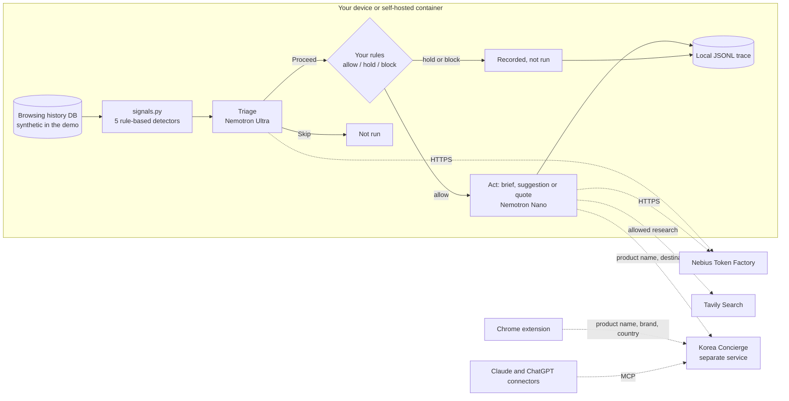

# Beforehand

**Beforehand: a personal AI that knows before you ask.**

Beforehand flags browsing patterns that may deserve a follow-up, proposes one, and runs it only if your rules allow it. A pattern can be a search you never followed up, a setup page you visited once, a project that went quiet or a Korean product you viewed on two different days. For that last case the follow-up is a Korea price quote, and the agent always stops at the quote.

Built for the Nebius × NVIDIA Global AI Hackathon (Personal AI track).

## What it does

Beforehand has three parts. This repository holds the first two.

| Part | What it does | In this repo |
|---|---|---|
| Browsing agent (`browsing/`) | Detects signals in browsing history, triages each one with NVIDIA Nemotron on Nebius Token Factory, checks the proposed action against your rules in code (allow, hold or block), then writes a research brief, a setup suggestion or a Korea quote, and records everything in a local JSONL trace | Yes, Apache-2.0 |
| Chrome extension (`extension/`) | Shows the Korea delivered price, or Korean alternatives, for the product you are viewing on 22 supported shops | Yes, Apache-2.0 |
| Korea Concierge | The quote service both parts call over HTTPS. It is also published as a connector for Claude and ChatGPT | No. A separate service run by the developer of Beforehand |

The agent starts from what you already did, not from a new prompt. Five rule-based detectors look for signals: `new_entry` (a first visit to a setup or signup page), `unresolved` (a search with no follow-through visit), `recurring` (repeat visits to one website), `dropped` (activity that went quiet) and `korea_product` (a Korean product viewed more than once). A visit is a signal, not proof of intent or of unfinished setup.

## Try it

- **Live demo:** https://port8080-dqwmnenkc4rf4bj.tunnel.applications.us-north1.nebius.cloud
- **Chrome extension:** load it unpacked (steps below).
- **Connectors:** Korea Concierge in the [Claude directory](https://claude.ai/directory/korea-concierge) and in [ChatGPT](https://chatgpt.com/plugins/plugin_asdk_app_6a766b80051c8191a0821d5b4c5dcedb).
- **Source:** https://github.com/launzi/beforehand

### What you see in the demo

The demo runs on a fictional browsing history: a hobby maker learning Python and planning a small creative project, Sep 1 to Oct 1, 2026 (UTC). No real account is touched by the demo or by its saved run.

- **Same history, three rule profiles.** Pick **Allow research & quotes**, **Block research & quotes** or **Hold research & quotes**. Loading a profile shows its saved results and makes no new calls.
- **Saved results.** The page shows results saved from a real API run on Oct 9, 2026, 03:02 UTC, labelled `CACHED · live · complete`. The **Saved-run comparison · same 9 signals** table counts each outcome per profile: Allowed ✓, Held ◐, Blocked ✕ and Skipped by model ○. Failed actions are counted separately.
- **One case to follow.** The Korean toner appears in every profile with the steps Model → Rules → Outcome. Under Allow it gets a quote card: about USD 76.70 estimated total from Korea to the US, against a USD 17.85 local reference price, with fees listed and import charges paid on delivery. The card says **Quote only. No order or payment is created.** Under Block and Hold the same case is marked **Not run**, blocked or held by your rules.
- **Hold means hold.** Under Hold, research and quotes wait while setup suggestions still run. To release held actions, switch profile and run again; the demo has no per-item approval.
- **Honest non-results.** When Korea Concierge cannot price an item, the card says **No quote returned** and that no order or payment was created. Blocked, held and failed results each state their own cause. Signals the model skipped are marked **Not run**, skipped by the model.
- **Live runs.** **Run agent** starts a real run with Nemotron, Tavily and Korea Concierge. Attempts are capped per UTC day and shared across the server; at 0 the button is disabled and the saved results stay on the page.

### Install the extension (unpacked)

You need Chrome 116 or later and Node.js.

```sh
cd extension
npm test
node scripts/build.mjs store
```

1. Open `chrome://extensions` and turn on **Developer mode**.
2. Click **Load unpacked** and select `extension/dist/store`.
3. Open a product page on a supported shop and choose auto-check or manual checks. The extension sends nothing until you make that choice.

The extension needs no AI account or API key. It can also start a purchase through Korea Concierge (card or PayPal); that path is optional and described in `extension/PRIVACY.md`. The browsing agent never buys anything.

## Architecture



The agent is a LangGraph loop (`triage → mandate → act`) in `browsing/agent.py`. Your rules are checked in code, not by the model: `browsing/mandate.py` evaluates each planned action deterministically and fails closed. An invalid rule file blocks everything, and `commerce.checkout` is always blocked. The three demo profiles are `browsing/mandate.toml` and the files in `browsing/web/profiles/`.

## How it uses Nebius Token Factory, Nemotron and Tavily

All provider calls live in `browsing/providers.py`, the replaceable provider layer.

- **Nebius Token Factory** is the inference API: `https://api.tokenfactory.nebius.com/v1/chat/completions`. At runtime the code lists `https://api.tokenfactory.nebius.com/v1/models` and picks the shortest model id that contains both `nemotron` and the requested tier (`nano`, `super`, `lightning` or `ultra`). Auth is `NEBIUS_API_KEY`.
- **NVIDIA Nemotron**, by tier (`browsing/agent.py`):
  - **Ultra** triages each signal (`TRIAGE_TIER = "ultra"`) with an evidence rubric per signal kind and an 8,192-token ceiling for reasoning plus output. That ceiling is a provisional cap, not measured usage.
  - **Nano** writes the follow-up text: two to three English sentences with an observation and one suggested next step. It also summarizes Korea quotes and must quote amounts exactly as supplied.
  - **Super** fills in the fictional persona history in `browsing/persona` (URLs, titles, times and search terms).
- **Tavily** (`https://api.tavily.com/search`, `TAVILY_API_KEY`) is the default search provider. It is called for an unresolved search only when triage says Proceed and your rules allow research. Skipped, held and blocked signals never reach Tavily.

The hosted demo runs as a CPU container on Nebius AI Cloud Serverless.

## Significant updates since 2026-08-26

All code in this repository was written during the submission period; the first `browsing/` commit is dated 2026-09-13. Beforehand is a new project. For Korea prices it calls Korea Concierge, a separate quote service that existed before the submission period and is not part of this repository.

- **2026-09-13:** URL scrubbing, idempotent ingest, classification, query layer, weekly digest, rule-based signal detection, the provider layer (Tavily and Nebius Token Factory) and the LangGraph agent loop with a local trace.
- **2026-10-03:** Rules layer (triage, then rules, then act) with deterministic, fail-closed verdicts and an audit trace. Fictional persona generator with signal validation, English web demo with run caps and saved results, and CPU container images. Ultra triage with per-signal rubrics, an `eval-live` command, and token limits raised to match measured Nemotron reasoning use. Korea quote skill (quote only) and the `commerce.quote` action kind. First Chrome MV3 extension.
- **2026-10-03 to 2026-10-10:** The extension became Beforehand: product extraction on 22 shops, a Shadow DOM price card, consent and privacy flows, and the Korea Concierge partner API for matches and checkout.
- **2026-10-09:** Agent aligned with the current Korea Concierge contract, quote card with seller and fees while checkout stays blocked, Korea product triage grounded in quote evidence, handling of unavailable quotes, and a reviewed saved run for the demo. A visitor's live run never replaces that saved run on the shared page.
- **2026-10-10:** Demo page v2. Default text states only observed evidence and actual outputs, with the original model output kept in the audit details. The page adds the Hold profile, the line that says where results come from, the outcome vocabulary with Skipped by model and Failed, a quote card that stays readable, and per-server run-budget wording.

## Repository layout

```text
browsing/            agent, detectors, rules, providers, persona generator, tests
browsing/web/        demo web app (Starlette, templates, rule profiles)
browsing/demo-assets/ saved run used by the demo page
extension/           Chrome MV3 extension (plain JavaScript modules, tests, privacy policy)
Dockerfile           demo web image
Dockerfile.job       one-shot persona generation job
```

## Self-host

Use Python 3.12.

### 1. Run the offline walkthrough

```sh
python -m pip install -r browsing/web/requirements.txt
DEMO_STATE_DIR=.demo-state python -m uvicorn browsing.web.app:create_app \
  --factory --host 127.0.0.1 --port 8080 --workers 1
```

Open `http://127.0.0.1:8080/`. No provider calls happen on startup, page views, profile selection or `GET /healthz`.

### 2. Generate a synthetic history DB (makes paid API calls)

The repository ships one synthetic DB, `browsing/demo-assets/korea-maker-20261003-010959.db`, so the demo and tests run from a clone. It is a fictional persona's generated history, with no real person, account or browser profile; see `browsing/demo-assets/README.md`. To generate a new one:

```sh
python -m browsing.persona generate \
  --scenario browsing/persona/scenarios/maker.toml \
  --out browsing/demo-assets/maker-YYYYMMDD-HHMMSS.db --attempts 3
```

Or build the one-shot job image:

```sh
docker build -f Dockerfile.job -t beforehand-persona-job .
# Run with NEBIUS_API_KEY at runtime and an output volume at /output writable by UID 10001.
# Default arguments: --scenario browsing/persona/scenarios/maker.toml --out /output/browsing.db
```

The generator feeds the existing ingest schema, runs the detectors and requires every planted signal to be found. It retries up to the `--attempts` bound and writes a DB plus an adjacent `.json` manifest. Review the generated text before you publish it.

### 3. Build and run the web container

```sh
docker build -f Dockerfile \
  --build-arg SYNTHETIC_DB=browsing/demo-assets/maker-YYYYMMDD-HHMMSS.db \
  -t beforehand-demo .
docker volume create beforehand-demo-state
docker run --rm -p 8080:8080 \
  -e NEBIUS_API_KEY -e TAVILY_API_KEY -e DEMO_DAILY_LIMIT=20 \
  -v beforehand-demo-state:/state beforehand-demo
```

The image listens on port 8080, runs as UID 10001 and checks `/healthz`. No LLM runs during the image build, and no key is a build argument.

### Environment variables

| Variable | Purpose |
|---|---|
| `NEBIUS_API_KEY` | Nebius Token Factory (Nemotron) |
| `TAVILY_API_KEY` | Tavily search |
| `SERPER_API_KEY` | Optional alternative search provider |
| `DEMO_DB` | Synthetic DB path (the image sets `/app/synthetic/browsing.db`) |
| `DEMO_STATE_DIR` | Writable state for the daily budget, saved results and traces (default `.demo-state`; the image uses `/state`) |
| `DEMO_DAILY_LIMIT` | Live runs per UTC day, default `20`; `0` disables live runs |
| `DEMO_CACHE` | Optional exported cache of successful runs, so the walkthrough renders during provider outages |

Run one replica with persistent state. Independent replicas would split the daily budget. See `browsing/README.md` for cache export, live evaluation and the full set of limits.

### Tests

```sh
python -m pytest browsing -q -p no:cacheprovider
cd extension && npm test
```

Tests use fake providers and fixtures. They do not call live APIs.

## Privacy

- **Synthetic data only in the demo.** The hosted demo uses an entirely fictional persona. No real browser data is deployed.
- **Local first.** Raw history stays on your device; only scrubbed, minimal fragments are used for inference. Search queries go to the selected search provider. Traces are local JSONL files: inspectable audit records, not cryptographic attestation.
- **No account access.** No OAuth, passwords or email access.
- **Extension.** Only when auto-check is on, or you click **Check Korea price**, it sends the product name, brand and delivery country to Korea Concierge. It cannot read your browsing history. The page address, page price and other tabs never leave your device. If you choose to buy, your email and name go to Korea Concierge to create the order. See `extension/PRIVACY.md`.

## License

Apache-2.0. See `LICENSE` and `NOTICE`.

Korea Concierge, the quote service these components call over HTTPS, is a separate service and is not part of this repository.
